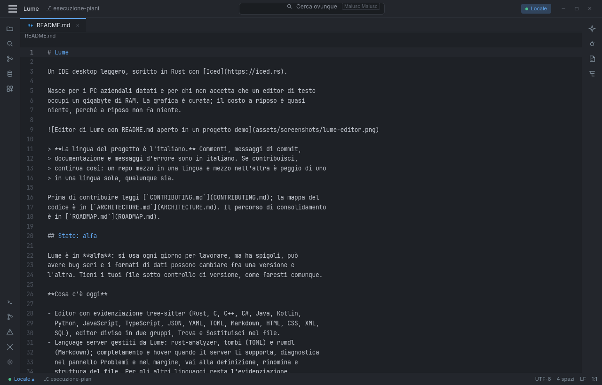

# Lume

Un IDE desktop leggero, scritto in Rust con [Iced](https://iced.rs).

Nasce per i PC aziendali datati e per chi non accetta che un editor di testo
occupi un gigabyte di RAM. La grafica è curata; il costo a riposo è quasi
niente, perché a riposo non fa niente.



> **La lingua del progetto è l'italiano.** Commenti, messaggi di commit,
> documentazione e messaggi d'errore sono in italiano. Se contribuisci,
> continua così: un repo mezzo in una lingua e mezzo nell'altra è peggio di uno
> in una lingua sola, qualunque sia.

Prima di contribuire leggi [`CONTRIBUTING.md`](CONTRIBUTING.md); la mappa del
codice è in [`ARCHITECTURE.md`](ARCHITECTURE.md). Che cosa arriva dopo questa
alpha è in [`ROADMAP.md`](ROADMAP.md).

## Stato: alfa

Lume è in **alfa**: si usa ogni giorno per lavorare, ma ha spigoli, può
avere bug seri e i formati di dati possono cambiare fra una versione e
l'altra. Tieni i tuoi file sotto controllo di versione, come faresti comunque.

La prima release pubblica è la **0.4.0 alpha**, qualificata su Linux x86_64:
i limiti di quella qualifica sono elencati in «Limiti noti di questa alpha»,
sotto «Installare».

**Cosa c'è oggi**

- Editor con evidenziazione tree-sitter (Rust, C, C++, C#, Java, Kotlin,
  Python, JavaScript, TypeScript, JSON, YAML, TOML, Markdown, HTML, CSS, XML,
  SQL), editor diviso in due gruppi, Trova e Sostituisci nel file.
- Language server gestiti da Lume: rust-analyzer, tombi (TOML) e rumdl
  (Markdown); completamento, hover e firma della funzione quando il server
  li supporta, diagnostica nel pannello Problemi e nel margine, vai alla definizione, rinomina e
  struttura del file. Per gli altri linguaggi resta l'evidenziazione.
  Il routing attuale usa un server per documento; non combina più server
  sullo stesso file.
- Terminale integrato con PTY reale.
- Git: stato, diff, stage per hunk, commit, log, branch, fetch, pull, push,
  blame e stash (salva, elenca, applica, rimuovi). Le operazioni che usano
  Git CLI sono elencate sotto.
- Cerca ovunque: file, azioni, simboli; ricerca nei file del progetto.
- Database: console SQL per Azure SQL / SQL Server e Oracle, con i segreti nel
  portachiavi di sistema.
- Temi colore e temi icone; Appunti (anteprima).

**Da completare o verificare:** debug tramite DAP e sviluppo remoto via SSH
non sono implementati. Il server MCP non offre ancora cataloghi/query SQL;
le decisioni di sicurezza e le prove native per questa integrazione restano
aperte. L'accettazione visuale dell'interfaccia e la verifica nativa completa
su Linux e macOS restano da fare.

### Eccezione: git CLI

Git in Lume è nativo (gitoxide). L'eccezione prevista per push, cambio di
branch, applicazione degli stash e merge locale con conflitti usa il programma
`git` sul `PATH`. I comandi sono collegati al pannello Git, le azioni partono
su richiesta e i pulsanti che ne hanno bisogno spariscono se `git` non è
disponibile. Pull usa gitoxide per fast-forward e merge pulito; in caso di
conflitti non modifica il worktree. La cancellazione è cooperativa e il
contenimento dipende dal backend: i comandi Git CLI su Linux passano dal
supervisor subreaper, con prove sui discendenti che escono dal process group.
Su Windows il processo viene creato sospeso e assegnato a un Job Object prima
dell’avvio; questa implementazione è compilata, ma la prova nativa resta
aperta. Discendenti dei percorsi gitoxide e runtime macOS restano da
qualificare. Dettagli
in [`CONTRIBUTING.md`](CONTRIBUTING.md).

### Eccezione: jj CLI (opzionale)

Se il progetto è un workspace [Jujutsu](https://jj-vcs.dev) (contiene `.jj`)
e `jj` è nel `PATH`, Lume mostra un pannello con cambiamenti, stato e azioni
per descrivere, creare un cambiamento e fare push. Senza `.jj` il pannello
resta nascosto; senza `jj` non mostra pulsanti. I processi partono solo quando
apri o aggiorni il pannello o scegli un'azione. Dettagli in
[`CONTRIBUTING.md`](CONTRIBUTING.md).

Limiti noti del blocco SQL, oggi:

- **Oracle, CLOB e BLOB:** la cella mostra un segnaposto con la dimensione
  (`<CLOB · N byte>`), non il contenuto: il driver oracledb 26.0.0-beta.2 non
  espone la lettura dei Lob.
- **Oracle, tipi non mappati** (JSON, VECTOR, BFILE, cursori annidati): la
  cella mostra il nome del tipo.
- **Oracle:** TLS è il default anche senza prefisso davanti all'host.
  La connessione è TCP in chiaro solo con `tcp://` esplicito
  (vedi [`SECURITY.md`](SECURITY.md)).
- **Azure SQL / SQL Server:** di un batch con più SELECT la griglia mostra
  solo il primo result set.

## Installare

La prima release pubblica è **Lume 0.4.0 alpha**, qualificata su Linux
x86_64. L'artefatto è un archivio, non un installer:

- nome `lume-0.4.0-linux-x86_64-<sha12>.tar.gz`, dove `<sha12>` sono i primi
  dodici caratteri del commit da cui è stato costruito;
- accanto all'archivio ci sono il `.sha256` e una copia di `MANIFEST.json`,
  che elenca dimensione e SHA-256 di ogni file e riporta commit, versione e
  toolchain;
- l'archivio estratto si avvia con `./avvia-lume.sh`;
- `bash tools/installa_launcher_linux.sh` registra la copia estratta nel menu
  applicazioni dell'utente; nell'archivio lo stesso script si chiama
  `installa-launcher.sh`.

I pacchetti non sono installer e non contengono il bundle dei language server
(`servers`): Lume li scarica al primo uso, verificandone l'hash. Gli artefatti
non sono firmati né notarizzati: il sistema può mostrare un avviso al primo
avvio.

Si può sempre costruire dai sorgenti (vedi «Compilare»):

- **Windows:** `pwsh tools/build_release_bundle.ps1` costruisce `lume.exe` e lo
  zip di distribuzione con i language server, con i percorsi di build
  rimappati perché non finiscano nei log dei crash. Questa release non ha un
  artefatto Windows qualificato.
- **Linux:** `bash tools/pacchetto_unix.sh linux-x86_64` crea l'archivio in
  `artifacts/`, con le licenze richieste; `bash
  tools/verifica_pacchetto_unix.sh <archivio>` ne controlla contenuto e
  watchdog.
- **macOS:** lo stesso script di Linux, ma la 0.4.0 non ha un pacchetto
  macOS: arriverà con una versione successiva.

### Limiti noti di questa alpha

Lume 0.4.0 è una **alpha qualificata su Linux**: le funzioni di base (aprire,
modificare, salvare, chiudere, ripristinare la sessione, menu contestuale,
scritture Git, watcher e Appunti) sono verificate su Linux con prove reali.
Quello che segue non è verificato e non va considerato garantito; le stesse
voci, con più contesto, sono nelle
[note di rilascio](docs/note-di-rilascio-0.4.0.md).

- **Piattaforme.** I pacchetti sono per Linux x86_64 e Windows x64. Su
  Windows i test passano nella CI pubblica, ma l'uso reale (chooser, ACL,
  Cestino, `rename`, SMB, WSL e perdita di alimentazione) è stato collaudato
  solo su un binario del 23 ottobre. macOS non è in questa release.
  L'installazione su un host pulito non è stata provata.
- **Salvataggio.** Su Linux il replace atomico non conserva le ACL POSIX
  nominate né gli attributi estesi e non è garantito contro una perdita di
  alimentazione o contro uno scrittore esterno che cambi il file fra il
  controllo e il rename. La sostituzione è atomica per file, non è una
  transazione multi-file.
- **Database.** I driver Azure SQL/SQL Server e Oracle sono compilati e
  coperti da test di protocollo, ma non sono stati eseguiti contro un
  database reale: TLS, tipi LOB, streaming, cancellazione e privilegi
  read-only restano non qualificati.
- **MCP.** Il server MCP è sperimentale e fuori dal default: si ottiene
  compilando con la feature Cargo `mcp`. È provato solo su Linux, con socket
  reali e con il ponte `lume --mcp-stdio`; nessun client esterno reale è
  stato collegato e Windows e macOS non sono provati. I tool SQL non
  esistono e `run_command` non è pubblicato. Il confine delle scritture non è
  provato contro symlink, hard link o alias creati fra il controllo e la
  scrittura.
- **Editor e language server.** È qualificato un solo server reale
  (rust-analyzer); il routing usa un server per documento e un secondo server
  distinto non è provato. Le prove native di completamento, definizione,
  diagnostica e rinomina sono precedenti a questa release e non sono state
  rieseguite sul binario distribuito.
- **Git.** Fetch, pull, push, merge e stash sono provati su repository
  locali: autenticazione, TLS, credential helper e SSH verso un remote reale
  non sono stati esercitati.
- **Jujutsu.** Il pannello è opzionale e richiede `jj` nel `PATH`. È
  verificata la raccolta dell'ultimo processo all'uscita; caricamento,
  azioni, interfaccia, cambio di radice e quarantena non sono qualificati.
- **Firma e sicurezza.** Gli artefatti non sono firmati né notarizzati. La
  libdbus del vault su Linux è compilata dal sorgente e inclusa
  nell'eseguibile: una sua correzione di sicurezza arriva solo ricompilando
  Lume. Il vault è stato provato con gnome-keyring; KWallet non è stato
  provato. La CI su GitHub non è mai stata eseguita.
- **Prestazioni.** I budget di avvio (< 100 ms), digitazione (< 8 ms), 60 fps
  e riposo (< 150 MiB) sono definiti su Windows release e non sono misurati
  su questa release.
- **DAP e SSH.** Non sono implementati: esistono solo il design confermato e
  nessun runtime.

## Scorciatoie da tastiera

La tabella riporta le scorciatoie assegnate alle voci dei menù, più cinque che
non hanno una voce dedicata. Il riquadro si apre da **Aiuto → Scorciatoie…** e
mostra solo i comandi disponibili: le azioni LSP compaiono quando il server
attivo dichiara la capability richiesta e le funzionalità spente da
**Visualizza → Estensioni…** vengono omesse.

| Dove | Azione | Tasti |
|---|---|---|
| File | Nuovo file | `Ctrl+N` |
| File | Apri… | `Ctrl+O` |
| File | Salva | `Ctrl+S` |
| File | Salva tutto | `Ctrl+Maiusc+S` |
| File | Esci | `Alt+F4` |
| Modifica | Annulla | `Ctrl+Z` |
| Modifica | Ripeti | `Ctrl+Maiusc+Z` |
| Modifica | Taglia | `Ctrl+X` |
| Modifica | Copia | `Ctrl+C` |
| Modifica | Incolla | `Ctrl+V` |
| Modifica | Seleziona prossima occorrenza | `Ctrl+D` |
| Modifica | Trova… | `Ctrl+F` |
| Modifica | Sostituisci… | `Ctrl+R` |
| Modifica | Completa | `Ctrl+Spazio` |
| Visualizza | Terminale | `Alt+F12` |
| Visualizza | Estensioni… | `Ctrl+Maiusc+X` |
| Naviga | Vai al file… | `Ctrl+P` |
| Naviga | Cerca nei file… | `Ctrl+Maiusc+F` |
| Naviga | File recenti | `Ctrl+E` |
| Naviga | Vai a riga… | `Ctrl+G` |
| Naviga | Indietro | `Ctrl+Alt+←` |
| Naviga | Avanti | `Ctrl+Alt+→` |
| Naviga | Vai alla definizione | `Ctrl+B` |
| Naviga | Firma della funzione | `Ctrl+Maiusc+Spazio` |
| Naviga | Struttura | `Ctrl+F12` |
| Naviga | Trova utilizzi | `Alt+F7` |
| Naviga | Rinomina… | `Maiusc+F6` |
| Naviga | Segnalibro | `F11` |
| Altrove | Seleziona tutto | `Ctrl+A` |
| Altrove | Ripeti (alternativa) | `Ctrl+Y` |
| Altrove | Nuovo appunto | `Ctrl+Alt+N` |
| Altrove | Cerca ovunque | `doppio Maiusc` |
| Altrove | Chiudi il riquadro aperto | `Esc` |

Nell'editor, Alt+clic aggiunge o toglie un cursore. Ctrl+D seleziona la parola
e poi le occorrenze successive; Modifica offre anche «Aggiungi cursore sopra»
e «Aggiungi cursore sotto». Le modifiche agiscono su tutte le selezioni, con
un solo undo per gesto. Copia unisce i frammenti con un ritorno a capo e
Incolla ripete il testo completo in ogni selezione. Esc chiude prima il popup
o il riquadro aperto; poi conserva soltanto il cursore principale.

Il riquadro e questa tabella derivano dall'elenco `MENUS` in
`crates/lume-app/src/menu.rs`; i test falliscono se una nuova scorciatoia non
viene riportata qui.

## Dove salva i dati

| Cosa | Dove (Windows) |
|---|---|
| Sessione, impostazioni, connessioni SQL | `%LOCALAPPDATA%\lume\Lume\data\lume.sqlite3` |
| Language server scaricati da Lume | `%LOCALAPPDATA%\lume\Lume\data\language-servers\` |
| Log dei crash | `%LOCALAPPDATA%\lume\Lume\data\logs\` |
| Errori mostrati da Lume | `%LOCALAPPDATA%\lume\Lume\data\logs\errors.log` (rotazione: `errors.1.log`, `errors.2.log`) |
| Temi icone esterni | `%APPDATA%\lume\Lume\config\icon-themes\` |
| Password dei database | Gestione credenziali di Windows, mai su file |

Per disinstallare basta cancellare la cartella di Lume e quelle qui sopra.
La variabile d'ambiente `LUME_DATA_DIR` sposta tutti i dati in una cartella a
scelta (utile per provare Lume senza toccare il profilo).

## Segnalare un problema

Apri una [issue](https://github.com/Otacon-spec/lume/issues) indicando la versione
(menù Aiuto), il sistema operativo e la sua versione, e i passi per riprodurre
il problema. Se Lume si è chiuso da solo, allega l'ultimo file della cartella
dei log dei crash: contiene la versione, il messaggio d'errore, il punto del
codice e il backtrace, e la tua cartella utente vi compare come `~`.

Se Lume mostra un errore ma resta aperto, puoi allegare `errors.log` dalla
stessa cartella. Contiene gli errori mostrati più di recente, con i percorsi
del profilo utente sostituiti da `~`; il file e le due generazioni precedenti
occupano al massimo 768 KiB complessivi.

Per controllare che il log dei crash funzioni sulla tua macchina, avvia
`lume.exe --prova-crash` da un terminale: Lume si chiude subito e lascia un
file `crash-….log` nella cartella dei log, con il messaggio «crash di prova
richiesto con --prova-crash».

## Budget prestazionale

Non sono obiettivi, sono **vincoli**: una modifica che li sfonda non entra.

| Cosa | Limite |
|---|---|
| Avvio a finestra interattiva | < 100 ms |
| Latenza tastiera → schermo | < 8 ms |
| Scroll e animazioni | 60 fps |
| RAM a riposo, progetto medio | < 150 MiB di private bytes (progetto medio: il clone di Lume, una scheda `.rs` aperta, language server fermo, dock chiusi, misura a 30 s dall'avvio) |
| Undo (compreso nei private bytes) | al più 48 MiB in tutto, 16 MiB per documento; l'ultima operazione di ogni documento si conserva sempre |
| Thread e processi figli a riposo | nessun processo figlio se non hai avviato tu una shell, un language server o una connessione; i thread misurati a riposo sono nel paragrafo sotto la tabella |
| Lavoro da inattivo | nessun timer periodico nel codice di Lume, solo attese una tantum (ibernazione SQL dopo 5 minuti, quiete della ricerca 200 ms, notifica 5 s, rilevazione WSL alla prima apertura del selettore degli ambienti); lavorano solo i backend che avvii tu (shell, language server, connessioni SQL) e il watcher dei file, event-driven (su Windows il thread di notify si sveglia ogni 100 ms finché un progetto è aperto) |
| GPU dedicata | non richiesta (fallback software tiny-skia) |

Due di questi numeri **oggi non sono verificati**, e sono scritti qui invece
che nascosti: l'avvio è dominato da circa un secondo di inizializzazione
grafica che non è ancora stato affrontato, e la RAM a riposo in private bytes
ha una prima misura solo dalla rimisura qui sotto (la misura precedente, 199 MB
di working set a 8 s senza progetto, include le mappature del driver GPU e non
è confrontabile con questo limite). La RAM a riposo misurata il 2026-09-30 sul
commit e6238bd, con una scheda aperta (`main.rs`) e come progetto la sola
cartella che la contiene, è 246,27 MiB di private bytes (68 thread, 652
handle): sopra il budget.

### Misurare l'avvio

Il limite di 100 ms si misura, non si crede. Da spenta la traccia non crea
thread né timer: ai soli punti di misura controlla la variabile d'ambiente
`LUME_STARTUP_TRACE`. Si accende con qualunque valore diverso da `0`:

```powershell
$env:LUME_STARTUP_TRACE = 1; cargo run --release -p lume-app
```

Sullo stderr compare una riga per ogni tappa dell'avvio, poi, una volta sola,
il tempo al primo frame con l'esito «entro budget» o «FUORI BUDGET». Le misure
si prendono sulla build di release: quella di debug non è ottimizzata e
sovrastima.

La build Windows di release è un'applicazione grafica senza console. Per
leggere lo stderr di `lume.exe`, reindirizzalo su un file e aspetta che
l'applicazione termini:

```powershell
$env:LUME_STARTUP_TRACE = 1
Start-Process .\lume.exe -RedirectStandardError .\traccia.txt -Wait
Get-Content .\traccia.txt
```

## La regola zero-mock

Un controllo senza un backend che funziona **non viene disegnato** — non viene
disegnato in grigio, non viene disegnato disabilitato: non c'è. Un pulsante che
finge è un debito che qualcuno paga più tardi credendo a quel che vede.

È il motivo per cui in Lume mancano cose che nel prototipo si vedono: il tasto
Debug (vuole un client DAP), l'assistente AI, i servizi Docker. Torneranno
quando avranno qualcosa dietro.

## Server MCP (sperimentale)

Con la feature Cargo `mcp` Lume può esporre a un client locale l'editor, i file,
le diagnostiche, il language server e Git del progetto aperto, su una named
pipe (Windows) o un socket privato (Linux/macOS). Può anche scrivere file,
sostituire testo e rinominare simboli secondo la
modalità del progetto (Non brave, Auto, Brave). `run_command` non è pubblicato
né eseguibile: resta disattivato finché non sono decisi e provati i confini di
isolamento richiesti. La ricerca di cataloghi e l'esecuzione di query SQL non
sono collegate al server MCP. La feature è sperimentale e si avvia a mano da
Estensioni. Dettagli, configurazione e limiti noti in
[docs/mcp.md](docs/mcp.md).

## Limiti d'uso e comportamento

Questi sono i limiti del comportamento quotidiano, validi su ogni
piattaforma in cui Lume viene compilato; i limiti della release alpha sono in
«Limiti noti di questa alpha», sopra.

- **Salvataggio.** I file dell'editor e quelli chiusi modificati da
  «Sostituisci tutto» si sostituiscono atomicamente, uno per volta: un errore
  prima della sostituzione non tronca l'originale. Non è una transazione
  multi-file. Su Windows il temporaneo ha DACL protetta prima della scrittura
  e il commit conserva la DACL originale: filesystem senza ACL persistenti
  (per esempio FAT/exFAT) o protezioni non riproducibili vengono rifiutati.
  Gli errori parziali di `ReplaceFileW` non hanno rollback garantito dei nomi.
  Si conservano i permessi standard e i link simbolici esistenti, non tutti
  i metadati (ACL Unix, attributi estesi); altri hard link restano sul vecchio
  contenuto. L'I/O avviene su worker: prima del commit l'app rivalida
  documento, percorso e revisione. Gli edit successivi restano non salvati.
  Le modifiche esterne rilevate dal watcher o dal confronto dei byte bloccano
  il save ordinario; il buffer resta disponibile per «Salva con nome».
  Il confronto non elimina la race con writer esterni fra verifica e rename.
  Le prove native della politica Windows e del runtime macOS restano aperte.
- **Fetch Git.** «Annulla fetch» segnala il worker; il pannello resta occupato
  fino alla sua risposta. L'annullamento è cooperativo: non interrompe
  immediatamente ogni attesa di rete o di un credential helper.
- **File grandi.** L'editor apre file di testo UTF-8 fino a 32 MiB; oltre, dice
  perché e non apre nulla. Le schede riaperte all'avvio si leggono ancora
  tutte in una volta (con lo stesso tetto).
- **Oracle.** La connessione parla TLS di default (`tcps://`); il testo in
  chiaro esiste solo se scrivi `tcp://` tu, e il pannello lo segnala. Le radici
  di fiducia di Oracle sono quelle incorporate nel driver, non quelle del
  sistema: una CA aziendale privata non vale per Oracle. Una query Oracle
  già partita non si interrompe sul server (Azure SQL sì).
- **WSL.** Le distro si rilevano la prima volta che apri il selettore degli
  ambienti; una distro installata dopo compare al riavvio.
- **Dati.** Il database dell'app passa alla versione 5: una versione di Lume
  più vecchia non lo apre più.
- **Test.** Con uno strumento esterno assente (`git`, `rustc`, una shell PTY,
  `tasklist`/`taskkill` o `kill`) i test relativi saltano e lo dicono; vedi
  `CONTRIBUTING.md`.

## Compilare

```
cargo build --release
cargo test --workspace
```

Per far fallire (invece di saltare) i test a cui manca uno strumento esterno:
`LUME_TEST_RICHIEDI_STRUMENTI=1 cargo test --workspace`.

Serve Rust stabile, edition 2024 (`rust-version = 1.89`, verificata in CI).

Su Linux la cassaforte del sistema (Secret Service) parla libdbus compilata
dal sorgente dallo store `vendored` di `dbus-secret-service-keyring-store`:
serve un compilatore C (`cc`; su Ubuntu `build-essential`), non
`libdbus-1-dev`, e nessuna libdbus è richiesta a runtime. La versione di
libdbus è quella inclusa nel crate, non quella della distribuzione: gli
aggiornamenti di sicurezza arrivano ricompilando Lume (vedi `SECURITY.md`).

La feature Cargo `sql` è attiva di default. Per compilare Lume senza il
pannello Database né i driver Azure SQL/Oracle:

```
cargo check -p lume-app --bin lume --no-default-features
```

La CI controlla anche che `lume-sql`, `tiberius-ng` e `oracledb` siano assenti
dal grafo normale delle dipendenze e compila/testa il binario in questa
configurazione.

## Piattaforme

**Linux x86_64 è la piattaforma di questa prima alpha.** Su Linux passano la
suite del workspace e Clippy; il giro base dell'interfaccia è stato eseguito
su finestre vere sotto Xvfb, con oracoli sui file su disco. Restano fuori la
prova manuale completa su una sessione desktop e le misure dei budget.

**Windows 10/11 x64 resta la piattaforma principale di sviluppo**: il codice
compila e Clippy passa per Windows GNU, ma runtime, interfaccia nativa e
matrice di salvataggio non sono qualificati su questa release. macOS non è
mai stato eseguito. Linux e macOS sono l'obiettivo dichiarato; in questa
release solo Linux x86_64 porta una qualifica, e solo per ciò che le note di
rilascio elencano.

## Licenza

[Apache License 2.0](LICENSE), con il file [`NOTICE`](NOTICE).

Puoi usare, modificare e ridistribuire Lume per qualsiasi scopo, anche
commerciale. Se ridistribuisci Lume o un'opera derivata devi includere il
testo del `NOTICE` — «Lume — creato da mak
(https://github.com/Otacon-spec/lume)» — in modo leggibile nella documentazione,
nei crediti o nella schermata Informazioni, come chiede la sezione 4(d) della
licenza.

Le dipendenze e gli asset vendorizzati — icone, font, il fork di `tiberius-ng`
— hanno le loro licenze, elencate in
[`THIRD_PARTY_NOTICES.md`](THIRD_PARTY_NOTICES.md); i testi completi delle
licenze dei crate Rust sono in
[`THIRD_PARTY_LICENSES.md`](THIRD_PARTY_LICENSES.md), generato con
`cargo about generate -c about.toml about.hbs -o THIRD_PARTY_LICENSES.md`. Lo zip di
distribuzione contiene tutti questi testi, compresi quelli dei language
server, nella cartella `licenses`.
